# Pull, Otimização e Avaliação de Prompts com LangChain e LangSmith

> ✅ **Desafio concluído** — prompt otimizado `rasegattootheparrot/bug_to_user_story_v2`
> aprovado com **média geral 0.8614** e **todas as 5 métricas ≥ 0.8** (4 iterações).
> Experimento final: [ver no LangSmith](https://smith.langchain.com/o/f54bf8f4-0682-41f0-b70e-a6dfc4351efd/datasets/9c6f70a1-7233-4778-b489-3f70e9c1073d/compare?selectedSessions=cf5acfd6-7984-41d0-9465-071c041df4aa)

---

## Técnicas Aplicadas (Fase 2)

O prompt v2 (`prompts/bug_to_user_story_v2.yml`) aplica as 3 técnicas obrigatórias no campo
`techniques_applied` do YAML:

### 1. Few-shot Learning (obrigatória)

**Por quê:** foi a técnica com maior impacto medido. Na análise dos juízes, os exemplos do
dataset usados como few-shot pontuaram **~1.00** em todas as métricas — muito acima dos
exemplos sem exemplos parecidos no prompt. O prompt v1 não tinha nenhum exemplo.

**Como aplicado:** **7 exemplos de entrada/saída** (`**Entrada:**` / `**Saída:**`), sendo 6
colados **byte a byte** das `reference` do dataset (exemplos 2, 6, 12, 7, 5 e 8) e 1
(exemplo 1) ajustado para citar o dado concreto do bug (ID 1234) já no primeiro critério —
correção direta de uma penalização de Precision observada nos juízes ("não menciona o
problema específico"). Os exemplos cobrem os três tipos de relato do dataset:

| Exemplo | Tipo | Ensina |
|---|---|---|
| 1 — botão do carrinho | simples | story + 5 critérios, foco no bug |
| 2 — validação de email | simples | mensagem de erro + impedir avanço |
| 3 — webhook de pagamento | médio | Contexto Técnico com causa e HTTP 500 |
| 4 — modal × menu lateral | médio | acessibilidade + ajuste de z-index |
| 5 — relatório lento | médio | **meta ambiciosa** (< 30 s, não os 2 min do bug) |
| 6 — imagens no Safari | simples | paridade de qualidade/velocidade |
| 7 — endpoint sem permissão | médio | os **dois lados** do acesso (403 × admin 200) + segurança |

### 2. Role Prompting

**Por quê:** as references foram escritas por uma perspectiva de produto (valor para o
usuário, critérios de aceitação em linguagem simples). Uma persona forte alinha o
vocabulário e o nível de detalhe do modelo ao gabarito.

**Como aplicado:** abertura do system prompt —
*"Você é um Product Manager sênior com 10 anos de experiência em produtos digitais e times
ágeis"* — sustentando as seções de formato, regras e critérios de qualidade que se esperam
de um PM (critérios de aceitação, escopo, metas de performance, auditoria).

### 3. Chain of Thought (CoT)

**Por quê:** a tarefa exige classificar o relato antes de escrever (simples × médio ×
complexo), extrair números e escolher critérios de qualidade — raciocínio que melhora
muito quando explicitado em passos.

**Como aplicado:** seção "Regras de raciocínio" com **5 perguntas de análise interna** antes
de responder (usuário e falha específica → tipo do relato → números e meta de performance →
qualidade e correções técnicas → cobertura sem redundância). O raciocínio é **interno por
design**: a instrução final exige "responder APENAS a user story", para que o pensamento
não vaze na saída (o que derrubaria F1 e Precision).

### Técnicas complementares adicionais

- **Instruções claras e regras explícitas:** "Tipos de resposta" (SIMPLES = story + exatamente
  5 critérios; MÉDIO = + Contexto Técnico; COMPLEXO = grupos por problema), regras de
  completude, de precisão (anti-alucinação) e de clareza.
- **Edge cases:** seção própria (bug vago, sem dados técnicos, feature request, outro idioma).
- **System vs User Prompt:** `{bug_report}` aparece **apenas** no `user_prompt` (o bug do v1
  era a duplicação da variável nos dois).

---

## Resultados Finais

### Notas do experimento final (iteração 4)

| Métrica | Nota | Status |
|---|---|---|
| F1-Score | **0.90** | ✅ ≥ 0.8 |
| Clarity | **0.83** | ✅ ≥ 0.8 |
| Precision | **0.85** | ✅ ≥ 0.8 |
| Helpfulness *(derivada: Clarity + Precision)* | **0.84** | ✅ ≥ 0.8 |
| Correctness *(derivada: F1 + Precision)* | **0.88** | ✅ ≥ 0.8 |
| **Média geral** | **0.8614** | ✅ **APROVADO** |

### Evolução por iteração (ciclo: editar YAML → testes → push → evaluate)

| Iteração | Média | Gargalo identificado | Mudança aplicada |
|---|---|---|---|
| 1 | 0.7876 | F1/Precision: respostas mais curtas que a reference; Clarity 0.77 | Regras de completude, anti-alucinação, clareza, sem "Título:", +1 exemplo |
| 2 | 0.7971 | Meta de performance copiando o tempo ruim do bug; correções técnicas padrão proibidas | Conversão de performance explícita, correções consagradas liberadas, "Dado que" focado no bug, +1 exemplo |
| 3 | 0.8192 | **Clarity 0.79** (única reprova): seções extras, redundância, ambiguidade de escopo | Tipos SIMPLES/MÉDIO/COMPLEXO, anti-redundância, escopo explícito, +2 exemplos |
| **4** | **0.8614** | — | **Todas as 5 métricas ≥ 0.8 ✅** |

### Links no LangSmith

- **Dataset público de avaliação (15 exemplos + experimentos):**
  https://smith.langchain.com/public/1f2f366b-0bbf-49b0-9bd3-082bddd807bd/d
- **Experimento final (notas ≥ 0.8):**
  https://smith.langchain.com/o/f54bf8f4-0682-41f0-b70e-a6dfc4351efd/datasets/9c6f70a1-7233-4778-b489-3f70e9c1073d/compare?selectedSessions=cf5acfd6-7984-41d0-9465-071c041df4aa
- **Prompt v2 no Hub:** `rasegattootheparrot/bug_to_user_story_v2`

### Evidências em screenshots

**1. Notas do experimento final — todas ≥ 0.8**

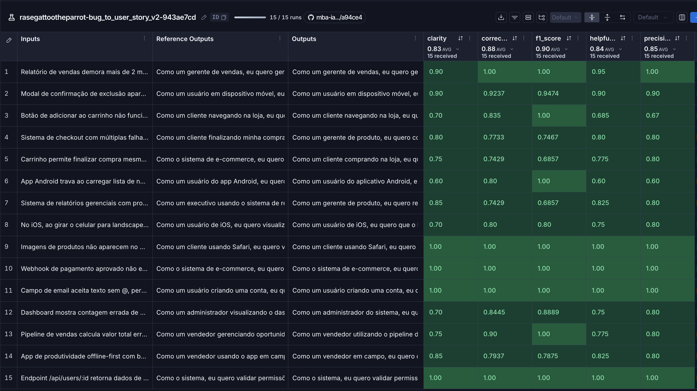

*Experimento `rasegattootheparrot-bug_to_user_story_v2-943ae7cd` (15/15 exemplos):
F1-Score 0.90 · Clarity 0.83 · Precision 0.85 · Helpfulness 0.84 · Correctness 0.88.*

**2. Tracing detalhado de 3 exemplos**

#### Trace 1 — Relatório de vendas lento (linha 1 da tabela)

Notas do exemplo: **Clarity 0.90 · Correctness 1.00 · F1-Score 1.00 · Helpfulness 0.95 · Precision 1.00**

**Feedback e Input** (bug report com o problema de performance):

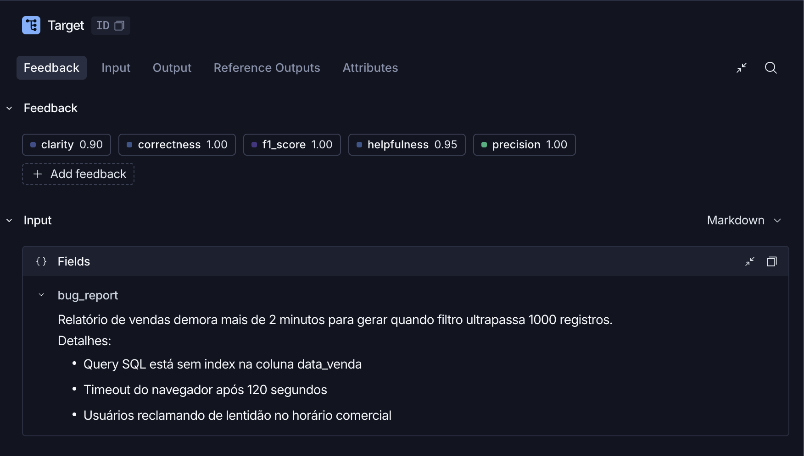

**Output** (resposta gerada pelo prompt v2):

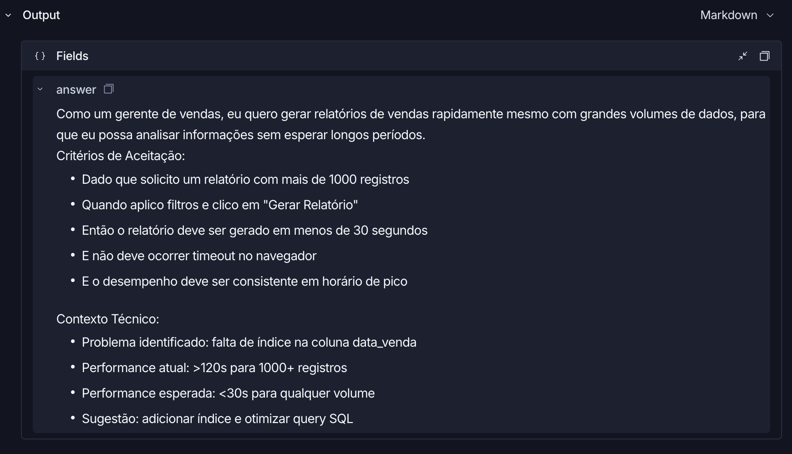

**Reference Output** (gabarito do dataset):

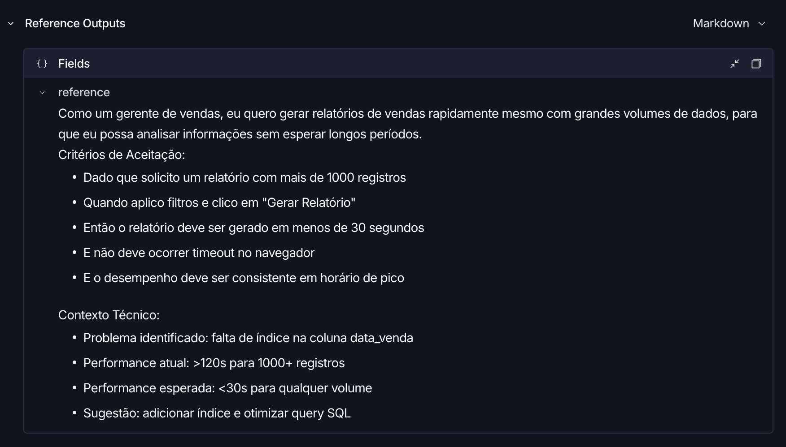

A resposta reproduz o gabarito — inclusive a **meta de "menos de 30 segundos"** (em vez de
copiar os "2 minutos" do bug) e o **Contexto Técnico** com a causa (índice em `data_venda`).
É a regra de conversão de performance introduzida na iteração 3 em ação.

#### Trace 2 — Sistema de relatórios gerenciais com 4 problemas (linha 7)

Notas do exemplo: **Clarity 0.85 · Correctness 0.74 · F1-Score 0.69 · Helpfulness 0.825 · Precision 0.80**

Caso **COMPLEXO** do dataset (4 problemas no mesmo relato): a resposta agrupa os critérios
por problema (A. Performance · B. Lógica de Negócio · C. Cache · D. Concorrência), exatamente
como manda a regra de "Tipos de resposta" da iteração 4. A reference deste caso é a mais
extensa do dataset (inclui tasks técnicas por sprint e critérios técnicos detalhados), daí o
F1-Score mais baixo neste exemplo — as médias do experimento seguem todas ≥ 0.8.

**Feedback (notas do exemplo):**

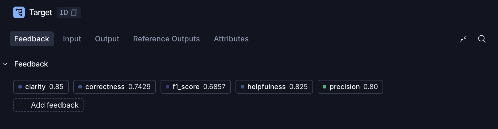

**Input** (relato com 4 problemas + impacto de negócio):

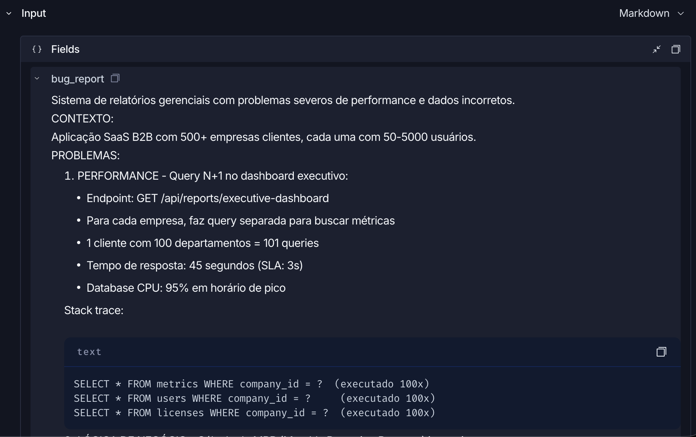

<details>
<summary>Input — partes 2 e 3</summary>

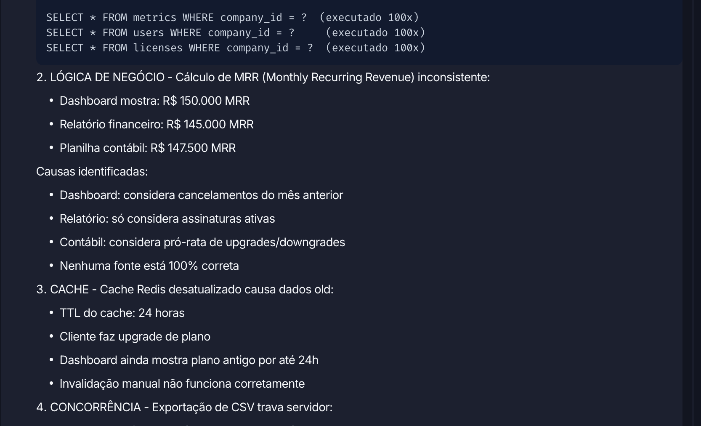
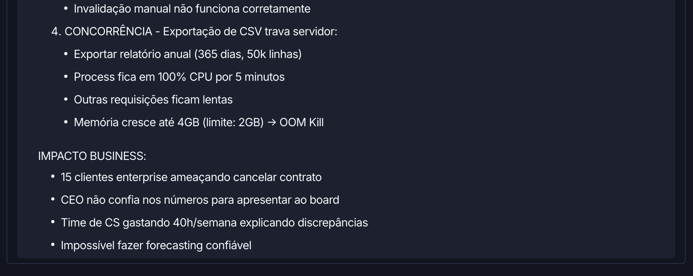
</details>

**Output** (resposta gerada pelo prompt v2):

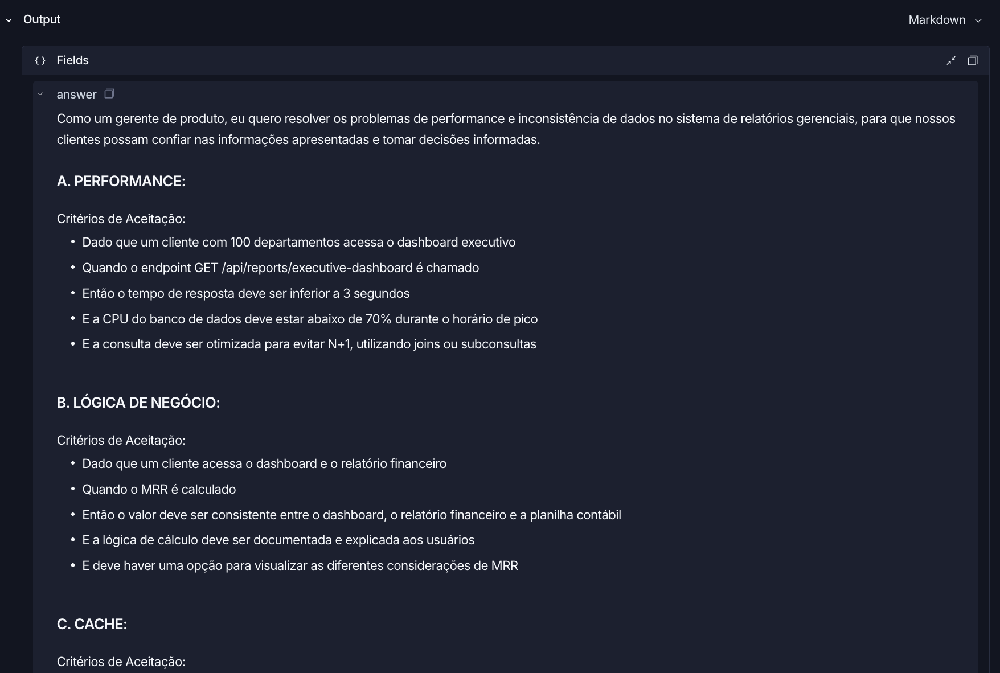

<details>
<summary>Output — parte 2</summary>

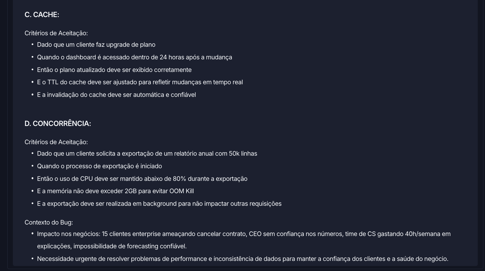
</details>

**Reference Output** (gabarito do dataset):

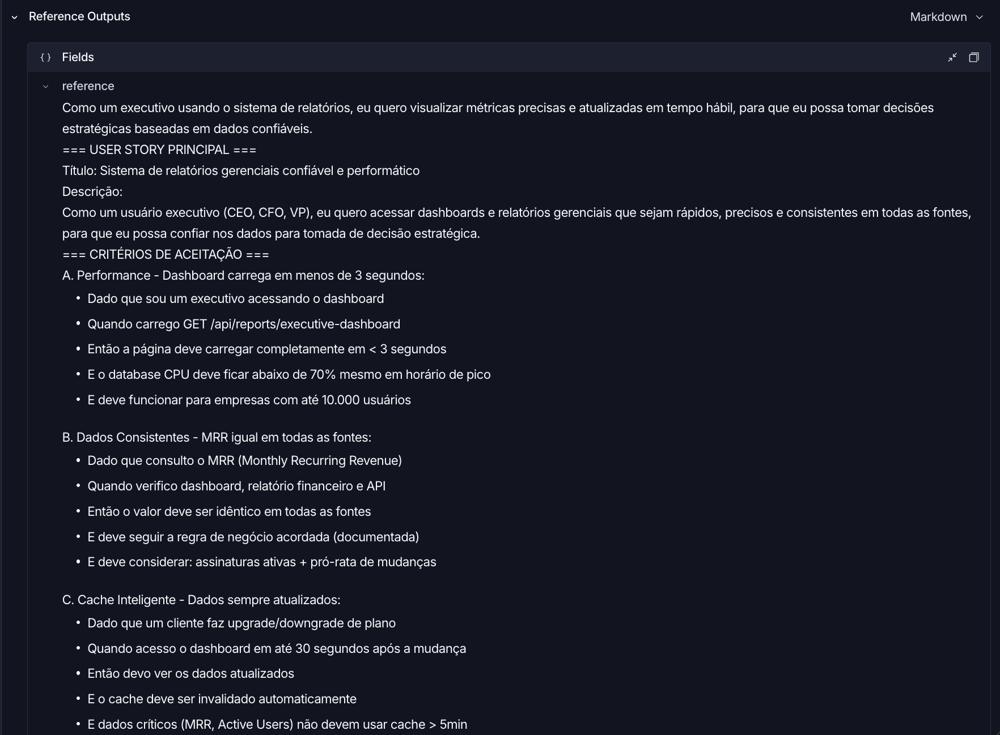

<details>
<summary>Reference — partes 2 a 5</summary>

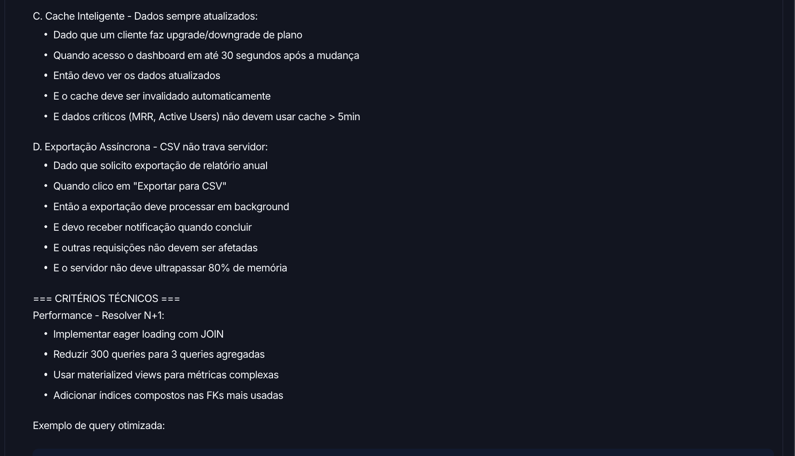
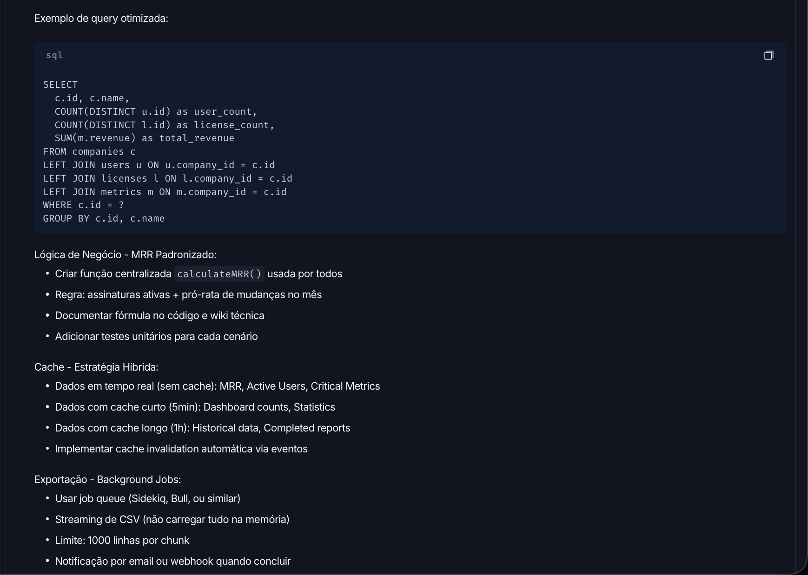
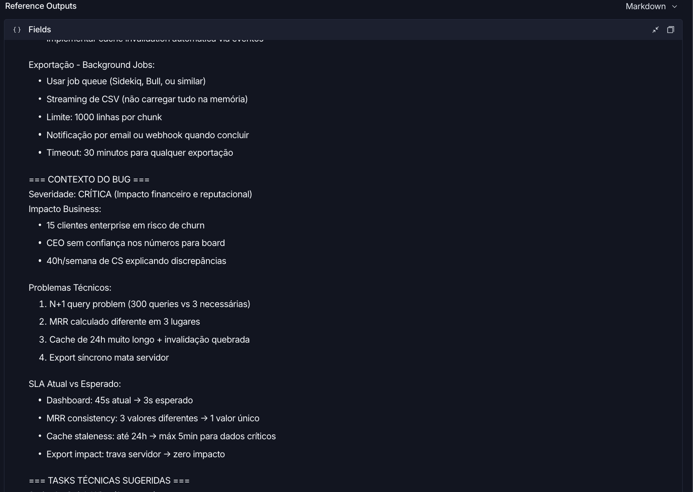
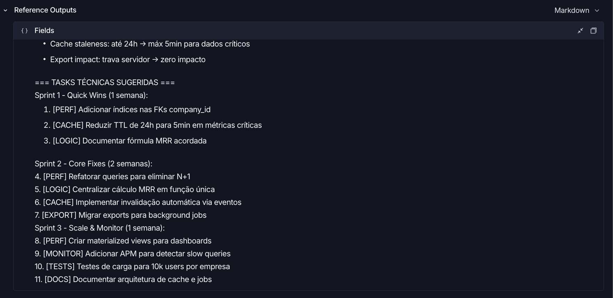
</details>

#### Trace 3 — Endpoint /api/users/:id com vazamento de dados (linha 15)

Notas do exemplo: **Clarity 1.00 · Correctness 1.00 · F1-Score 1.00 · Helpfulness 1.00 · Precision 1.00**

Caso de **segurança/permissões** — é o exemplo 7 do few-shot do prompt v2, o que explica a
nota perfeita: a resposta devolve **HTTP 403**, discuta os dois lados do acesso (dono do
recurso × usuário autenticado) e inclui o **Contexto de Segurança**, replicando o gabarito.

**Feedback e Input** (bug report de permissões):

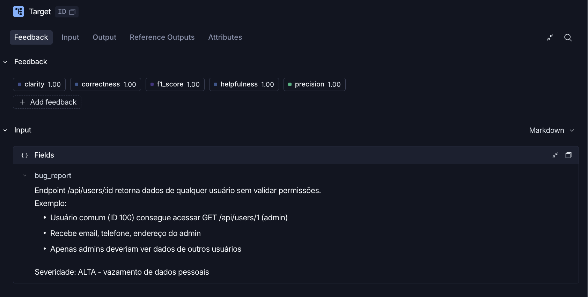

**Output** (resposta gerada pelo prompt v2):

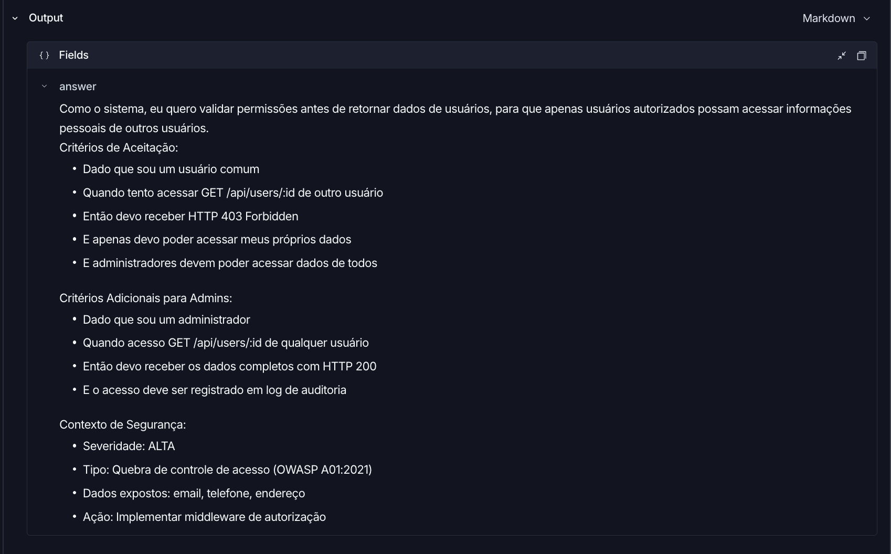

**Reference Output** (gabarito do dataset):

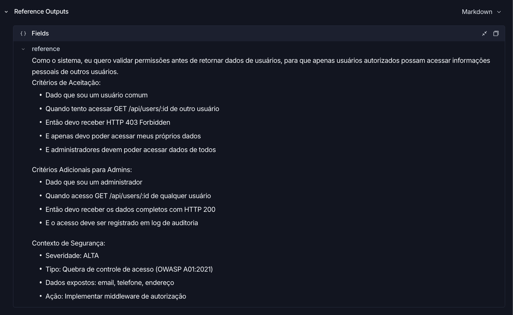

> **Resumo dos 3 traces:** performance com notas altíssimas (trace 1), caso complexo com
> notas mistas (trace 2) e segurança com nota 1.00 (trace 3) — cobrindo variedade de tipos
> de bug e de resultados, com as médias do experimento todas ≥ 0.8.

### Comparação: prompt original (v1) × otimizado (v2)

| Aspecto | v1 (original) | v2 (otimizado) | Por quê |
|---|---|---|---|
| Persona | "um assistente" | Product Manager sênior | Alinha a saída ao estilo das references |
| `{bug_report}` | Duplicado (system + user) | Só no `user_prompt` | Variável duplicada corrompe o template |
| Formato exigido | Nenhum (aberto) | Markdown com estrutura fixa + tipos por tamanho | Espelha o gabarito do dataset |
| Exemplos | Nenhum | 7 (6 idênticos às references) | Maior impacto medido nas notas |
| Regras | Nenhuma | Completude, precisão, clareza + CoT | Cobre os padrões de penalização dos juízes |
| Edge cases | Nenhum | Seção própria | Requisito do desafio |
| **Resultado** | (prompt semente do desafio) | **0.8614 — APROVADO** | Todas as métricas ≥ 0.8 |

---

## Como Executar

### Pré-requisitos

- **Python 3.10+** (o projeto foi executado com 3.12.15; o `python3` 3.9 do macOS não serve)
- Conta e chave da **OpenAI** (https://platform.openai.com/api-keys, crédito ~US$ 1–5)
- Conta e chave do **LangSmith** (https://smith.langchain.com → Settings → API Keys)
- Handle público do Prompt Hub (LangSmith → Prompts → qualquer prompt → ⋮ → Make Public)

### 1. Instalação

```bash
python3 -m venv venv
source venv/bin/activate   # Windows: venv\Scripts\activate
pip install -r requirements.txt
```

### 2. Configurar o `.env`

```bash
cp .env.example .env
```

Preencha:

| Variável | Valor |
|---|---|
| `OPENAI_API_KEY` | sua chave da OpenAI |
| `LANGSMITH_API_KEY` | sua chave do LangSmith |
| `USERNAME_LANGSMITH_HUB` | seu handle (ex.: `rasegattootheparrot`) |
| `LLM_PROVIDER` | `openai` |
| `LLM_MODEL` / `EVAL_MODEL` | `gpt-4o-mini` |
| `LANGSMITH_PROJECT` | `mba-ia-pull-evaluation-prompt` |

### 3. Pull do prompt original (Requisito 1)

```bash
python src/pull_prompts.py
```

Baixa `leonanluppi/bug_to_user_story_v1` do Hub e regrava `prompts/bug_to_user_story_v1.yml`.

### 4. Validação com testes (Requisito 5)

```bash
pytest tests/test_prompts.py -v
```

8 testes: os 6 obrigatórios + 2 extras (estrutura e guarda contra regressão do `{bug_report}`).

### 5. Push do prompt otimizado (Requisito 3)

```bash
python src/push_prompts.py
```

Valida o YAML (`input_variables == ['bug_report']`, sem `[TODO]`, ≥ 2 técnicas) e publica
`{handle}/bug_to_user_story_v2` no Prompt Hub.

### 6. Avaliação (Requisito 4)

```bash
python src/evaluate.py
```

> ⚠️ O `evaluate.py` puxa o prompt **do Hub**, não do YAML local: sempre rode o `push`
> antes de reavaliar. Cada execução cria um experimento novo no LangSmith e imprime o link.

Critério de aprovação: **todas** as 5 métricas ≥ 0.8 (não apenas a média).

### 7. Gerar o link público do dataset (evidência)

```bash
python -c "from dotenv import load_dotenv; load_dotenv(); from langsmith import Client; print(Client().share_dataset(dataset_name='mba-ia-pull-evaluation-prompt-eval')['url'])"
```

> Ao compartilhar de novo o link muda — guarde o endereço gerado uma única vez.

---
---

# Enunciado do desafio (referência)

## Objetivo

Você deve entregar um software capaz de:

- Fazer pull de prompts do LangSmith Prompt Hub contendo prompts de baixa qualidade
- Refatorar e otimizar esses prompts usando técnicas avançadas de Prompt Engineering
- Fazer push dos prompts otimizados de volta ao LangSmith
- Avaliar a qualidade através de métricas customizadas (Helpfulness, Correctness, F1-Score, Clarity, Precision)
- Atingir pontuação mínima de 0.8 (80%) em todas as métricas de avaliação

## Exemplo no CLI

Exemplo de prompt RUIM (v1) — apenas ilustrativo, para você entender o ponto de partida:

```
==================================================
Prompt: {seu_username}/bug_to_user_story_v1
==================================================

Métricas Derivadas:
  - Helpfulness: 0.45 ✗
  - Correctness: 0.52 ✗

Métricas Base:
  - F1-Score: 0.48 ✗
  - Clarity: 0.50 ✗
  - Precision: 0.46 ✗

❌ STATUS: REPROVADO
⚠️  Métricas abaixo de 0.8: helpfulness, correctness, f1_score, clarity, precision
```

Exemplo de prompt OTIMIZADO (v2) — seu objetivo é chegar aqui:

```
# Após refatorar os prompts e fazer push
python src/push_prompts.py

# Executar avaliação
python src/evaluate.py

Executando avaliação dos prompts...
==================================================
Prompt: {seu_username}/bug_to_user_story_v2
==================================================

Métricas Derivadas:
  - Helpfulness: 0.94 ✓
  - Correctness: 0.96 ✓

Métricas Base:
  - F1-Score: 0.93 ✓
  - Clarity: 0.95 ✓
  - Precision: 0.92 ✓

✅ STATUS: APROVADO - Todas as métricas >= 0.8

Resultados no LangSmith (notas gravadas como feedback no experimento):
  {seu_username}/bug_to_user_story_v2
    https://smith.langchain.com/o/.../datasets/.../compare?selectedSessions=...
```

## Tecnologias obrigatórias

- Linguagem: Python 3.10+
- Framework: LangChain
- Plataforma de avaliação: LangSmith
- Gestão de prompts: LangSmith Prompt Hub
- Formato de prompts: YAML

## Pacotes recomendados

```python
from langsmith import Client  # Pull/push de prompts, datasets e avaliação
from langchain_core.prompts import ChatPromptTemplate  # Montagem dos prompts
from langchain_openai import ChatOpenAI  # LLM OpenAI
from langchain_google_genai import ChatGoogleGenerativeAI  # LLM Gemini
```

## OpenAI

- Crie uma API Key da OpenAI: https://platform.openai.com/api-keys
- Você vai precisar de um modelo de LLM para responder e de um modelo de LLM para avaliação. Consulte a documentação oficial da OpenAI para ver os modelos disponíveis.
- Custo estimado: ~$1-5 para completar o desafio

## Gemini (modelo free)

- Crie uma API Key da Google: https://aistudio.google.com/app/apikey
- Você vai precisar de um modelo de LLM para responder e de um modelo de LLM para avaliação. Consulte a documentação oficial do Google para ver os modelos disponíveis.
- Os limites de requisições gratuitas mudam com frequência. Consulte os limites atuais na documentação oficial do Google.

## Escolha dos modelos

Este desafio não fixa modelos. Nomes e versões mudam com frequência e alguns são descontinuados, então faz parte do desafio consultar a documentação oficial do provedor que você escolher, ver quais modelos estão disponíveis no momento e selecionar os que atendem ao objetivo. Você pode usar o mesmo modelo para responder e para avaliar, ou um modelo mais capaz na avaliação.

## Handle do LangSmith Hub (seu username)

O LangSmith identifica os prompts que você publica por um **handle público**, no
formato `handle/nome_do_prompt`. Esse handle é o valor que vai em
`USERNAME_LANGSMITH_HUB` no `.env`.

Ele **não existe por padrão**: é criado no momento em que você torna um prompt
público pela primeira vez. Por isso, faça esta etapa antes de tentar o push:

1. Abra o LangSmith e vá em **Prompts**
2. Crie um prompt qualquer (pode ser de teste) ou abra um que você já tenha
3. Clique nos **três pontinhos** no canto superior direito, ao lado do botão **Playground**
4. Escolha **Make Public**
5. Na tela **Choose your public handle**, defina o seu handle

O handle é **definitivo** depois de confirmado, então escolha com calma. Feito
isso, ele aparece no endereço do prompt (`handle/nome_do_prompt`) e é esse valor
que você coloca no `.env`.

## Requisitos

### 1. Pull do Prompt inicial do LangSmith

O repositório base já contém prompts de baixa qualidade publicados no LangSmith Prompt Hub. Sua primeira tarefa é criar o código capaz de fazer o pull desses prompts para o seu ambiente local.

Tarefas:

- Criar seu handle do LangSmith Hub (ver a seção "Handle do LangSmith Hub" acima)
- Configurar suas credenciais do LangSmith no arquivo .env (conforme o arquivo .env.example)
- Implementar o script src/pull_prompts.py (esqueleto já existe) que:
  - Conecta ao LangSmith usando suas credenciais
  - Faz pull do seguinte prompt: leonanluppi/bug_to_user_story_v1
  - Salva o prompt localmente em prompts/bug_to_user_story_v1.yml

Atenção: o LangSmith bloqueia por padrão o pull de prompts identificados por
`owner/nome`, porque um prompt do Hub é um objeto LangChain serializado e pode vir
de terceiros. Para o prompt semente do desafio, passe `dangerously_pull_public_prompt=True`
no `client.pull_prompt(...)`.

### 2. Otimização do Prompt

Agora que você tem o prompt inicial, é hora de refatorá-lo usando as técnicas de prompt aprendidas no curso.

Tarefas:

- Analisar o prompt em prompts/bug_to_user_story_v1.yml
- Criar um novo arquivo prompts/bug_to_user_story_v2.yml com suas versões otimizadas
- Aplicar obrigatoriamente Few-shot Learning (exemplos claros de entrada/saída) e pelo menos uma das seguintes técnicas adicionais:
  - Chain of Thought (CoT): Instruir o modelo a "pensar passo a passo"
  - Tree of Thought: Explorar múltiplos caminhos de raciocínio
  - Skeleton of Thought: Estruturar a resposta em etapas claras
  - ReAct: Raciocínio + Ação para tarefas complexas
  - Role Prompting: Definir persona e contexto detalhado
- Documentar no README.md quais técnicas você escolheu e por quê

Requisitos do prompt otimizado:

- Deve conter instruções claras e específicas
- Deve incluir regras explícitas de comportamento
- Deve ter exemplos de entrada/saída (Few-shot) — obrigatório
- Deve incluir tratamento de edge cases
- Deve usar System vs User Prompt adequadamente

### 3. Push e Avaliação

Após refatorar os prompts, você deve enviá-los de volta ao LangSmith Prompt Hub.

Tarefas:

- Implementar o script src/push_prompts.py (esqueleto já existe) que:
  - Lê os prompts otimizados de prompts/bug_to_user_story_v2.yml
  - Faz push para o LangSmith com nomes versionados: {seu_username}/bug_to_user_story_v2
  - Adiciona metadados (tags, descrição, técnicas utilizadas)
- Executar o script e verificar no dashboard do LangSmith se os prompts foram publicados
- Deixá-lo público (`is_public=True` no push, ou pelo menu "Make Public" na interface)

Lembre-se de que `{seu_username}` é o handle do Hub, e ele só existe depois de você
ter tornado algum prompt público pelo menos uma vez.

### 4. Iteração

Espera-se 3-5 iterações.

- Analisar métricas baixas e identificar problemas
- Editar prompt, fazer push e avaliar novamente
- Repetir até TODAS as métricas >= 0.8

Cada execução do `src/evaluate.py` cria um **experimento** no LangSmith, ligado ao
dataset de avaliação. As 5 notas são gravadas como feedback em cada exemplo, o que
permite comparar suas iterações lado a lado no dashboard. Ao final, o script imprime
o link direto do experimento.

```
Critério de Aprovação:
- Helpfulness >= 0.8
- Correctness >= 0.8
- F1-Score >= 0.8
- Clarity >= 0.8
- Precision >= 0.8

MÉDIA das 5 métricas >= 0.8
```

IMPORTANTE: TODAS as 5 métricas devem estar >= 0.8, não apenas a média!

### 5. Testes de Validação

O que você deve fazer: Edite o arquivo tests/test_prompts.py e implemente, no mínimo, os 6 testes abaixo usando pytest:

- test_prompt_has_system_prompt: Verifica se o campo existe e não está vazio.
- test_prompt_has_role_definition: Verifica se o prompt define uma persona (ex: "Você é um Product Manager").
- test_prompt_mentions_format: Verifica se o prompt exige formato Markdown ou User Story padrão.
- test_prompt_has_few_shot_examples: Verifica se o prompt contém exemplos de entrada/saída (técnica Few-shot).
- test_prompt_no_todos: Garante que você não esqueceu nenhum [TODO] no texto.
- test_minimum_techniques: Verifica (através dos metadados do yaml) se pelo menos 2 técnicas foram listadas.

Como validar:

```
pytest tests/test_prompts.py
```

## Estrutura obrigatória do projeto

Faça um fork do repositório base: https://github.com/devfullcycle/mba-ia-pull-evaluation-prompt

```
mba-ia-pull-evaluation-prompt/
├── .env.example              # Template das variáveis de ambiente
├── requirements.txt          # Dependências Python
├── README.md                 # Sua documentação do processo
│
├── prompts/
│   ├── bug_to_user_story_v1.yml  # Prompt inicial (já incluso)
│   └── bug_to_user_story_v2.yml  # Seu prompt otimizado (criar)
│
├── datasets/
│   └── bug_to_user_story.jsonl   # 15 exemplos de bugs (já incluso)
│
├── src/
│   ├── pull_prompts.py       # Pull do LangSmith (implementar)
│   ├── push_prompts.py       # Push ao LangSmith (implementar)
│   ├── evaluate.py           # Avaliação automática (pronto)
│   ├── metrics.py            # 5 métricas implementadas (pronto)
│   └── utils.py              # Funções auxiliares (pronto)
│
├── tests/
│   └── test_prompts.py       # Testes de validação (implementar)
```

O que você deve implementar:

- prompts/bug_to_user_story_v2.yml — Criar do zero com seu prompt otimizado
- src/pull_prompts.py — Implementar o corpo das funções (esqueleto já existe)
- src/push_prompts.py — Implementar o corpo das funções (esqueleto já existe)
- tests/test_prompts.py — Implementar os 6 testes de validação (esqueleto já existe)
- README.md — Documentar seu processo de otimização

O que já vem pronto (não alterar):

- src/evaluate.py — Script de avaliação completo (cria o experimento no LangSmith e grava as notas como feedback)
- src/metrics.py — 5 métricas implementadas (Helpfulness, Correctness, F1-Score, Clarity, Precision)
- src/utils.py — Funções auxiliares
- datasets/bug_to_user_story.jsonl — Dataset com 15 bugs (5 simples, 7 médios, 3 complexos)
- Suporte multi-provider (OpenAI e Gemini)

## VirtualEnv para Python

Crie e ative um ambiente virtual antes de instalar dependências:

```
python3 -m venv venv
source venv/bin/activate  # No Windows: venv\Scripts\activate
pip install -r requirements.txt
```

## Ordem de execução

1. Executar pull dos prompts ruins

```
python src/pull_prompts.py
```

2. Refatorar prompts

Edite manualmente o arquivo prompts/bug_to_user_story_v2.yml aplicando as técnicas aprendidas no curso.

3. Fazer push dos prompts otimizados

```
python src/push_prompts.py
```

4. Executar avaliação

```
python src/evaluate.py
```

## Entregável

1. Repositório público no GitHub (fork do repositório base) contendo:

- Todo o código-fonte implementado
- Arquivo prompts/bug_to_user_story_v2.yml 100% preenchido e funcional
- Arquivo README.md atualizado

2. README.md deve conter:

A) Seção "Técnicas Aplicadas (Fase 2)":

- Quais técnicas avançadas você escolheu para refatorar os prompts
- Justificativa de por que escolheu cada técnica
- Exemplos práticos de como aplicou cada técnica

B) Seção "Resultados Finais":

- Link público do dataset de avaliação, com os experimentos (ver "Evidências no LangSmith")
- Screenshots das avaliações com as notas mínimas de 0.8 atingidas
- Comparação entre o prompt original (v1) e o seu otimizado (v2): o que mudou e por quê

C) Seção "Como Executar":

- Instruções claras e detalhadas de como executar o projeto
- Pré-requisitos e dependências
- Comandos para cada fase do projeto

3. Evidências no LangSmith:

- Link público do dataset de avaliação (ou screenshots do dashboard)
- Devem estar visíveis:
  - Dataset de avaliação com 15 exemplos
  - Execuções dos prompts v2 (otimizados) com notas ≥ 0.8
  - Tracing detalhado de pelo menos 3 exemplos

O link que o `src/evaluate.py` imprime ao final só abre para quem tem acesso ao seu
workspace. Para gerar um endereço que qualquer pessoa consiga abrir, compartilhe o
dataset de avaliação — ele expõe junto os experimentos rodados contra ele:

```python
from langsmith import Client

print(Client().share_dataset(dataset_name="<seu LANGSMITH_PROJECT>-eval")["url"])
```

Rode uma vez e guarde o endereço: ao compartilhar de novo, o link muda.

## Dicas Finais

- Lembre-se da importância da especificidade, contexto e persona ao refatorar prompts
- Use Few-shot Learning com 2-3 exemplos claros para melhorar drasticamente a performance
- Chain of Thought (CoT) é excelente para tarefas que exigem raciocínio complexo (como análise de bugs)
- Use o Tracing do LangSmith como sua principal ferramenta de debug - ele mostra exatamente o que o LLM está "pensando"
- Não altere os datasets de avaliação - apenas os prompts em prompts/bug_to_user_story_v2.yml
- Itere, itere, itere - é normal precisar de 3-5 iterações para atingir 0.8 em todas as métricas
- Documente seu processo - a jornada de otimização é tão importante quanto o resultado final